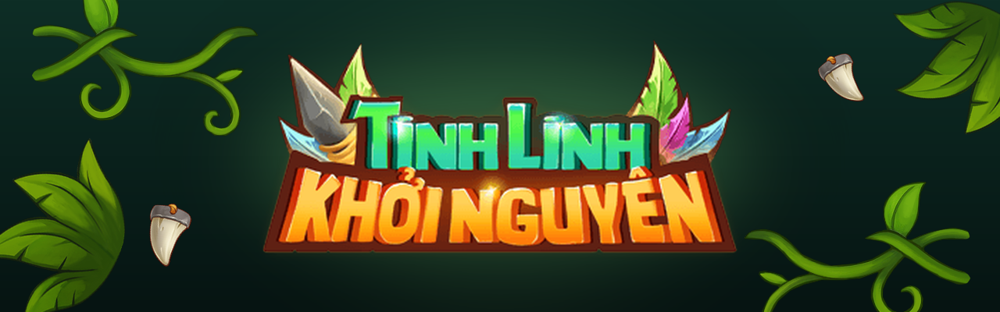
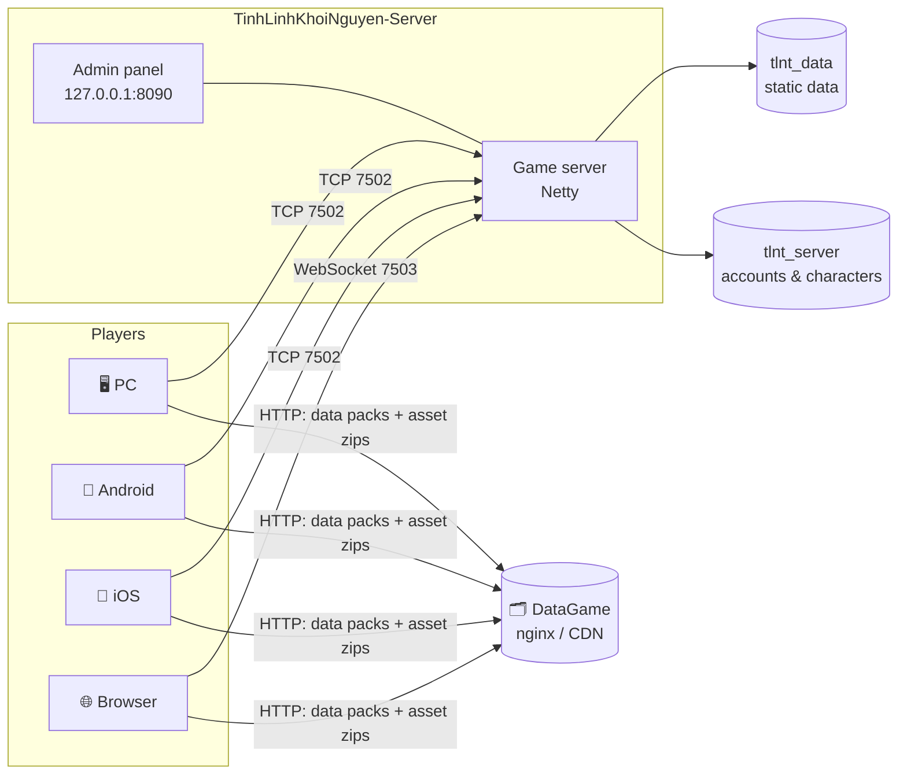

<div align="center">



### Source code of the 2D online RPG **Tinh Linh Khởi Nguyên** (TLNT)

<p>
  
  
  
  
</p>
<p>
  
  
  
  
  
  
</p>

[**Client**](TinhLinhKhoiNguyen-Client/) · [**Server**](TinhLinhKhoiNguyen-Server/) · [**Quick start**](#-quick-start) · [**Architecture**](#-architecture)

</div>

---

## 📦 What's inside

<table>
  <tr>
    <td width="50%" valign="top">
      <h3>🎮 <a href="TinhLinhKhoiNguyen-Client/">TinhLinhKhoiNguyen-Client</a></h3>
      <p>libGDX client: one Java code base for <b>Windows PC, Android, Web (HTML5) and iOS</b>.</p>
      <ul>
        <li>Spine skeleton animation, encrypted asset packs</li>
        <li>Web build via TeaVM (JavaScript + WebAssembly)</li>
        <li>One-command release builds with <code>build.bat</code></li>
      </ul>
      <p>➡️ <a href="TinhLinhKhoiNguyen-Client/README.md">Client README</a></p>
    </td>
    <td width="50%" valign="top">
      <h3>🖥️ <a href="TinhLinhKhoiNguyen-Server/">TinhLinhKhoiNguyen-Server</a></h3>
      <p>Java 17 game server on <b>Netty</b> + <b>MySQL / MariaDB</b>, with the <code>DataGame</code> resource files.</p>
      <ul>
        <li>TCP for native clients, WebSocket for the browser</li>
        <li>Built-in web admin panel</li>
        <li>SQL setup files and an asset-key checker</li>
      </ul>
      <p>➡️ <a href="TinhLinhKhoiNguyen-Server/README.md">Server README</a></p>
    </td>
  </tr>
</table>

## ✨ Game features

| | | |
|---|---|---|
| ⚔️ **Combat & PvP**: skills, combos, critical hits, PK | 🐉 **World bosses**: altars, Thunder Field, Linh Mộc dungeon | 🏆 **Tournaments & rankings**: weekly top, arena |
| 🛡️ **Tribes**: tribe skills, emblems, logs | 🔨 **Forging**: upgrade, refine, elements, souls, brewing | 🐾 **Pets & badges** |
| 🎣 **Life skills**: fishing, farming, gathering, plants | 💰 **Economy**: market, trading, shops, mail | 📜 **Quests**: main story, daily quests, achievements |
| 🎁 **Events**: lucky wheel, gift codes, welfare, Mid-Autumn | 💤 **Offline training** and auto-play | 🛠️ **Admin panel**: edit data live, manage accounts |

## 🧭 Architecture



On connect, the server sends the client the **asset decryption keys**, the **DataGame URL** and the
**server list**. The client then downloads any data or resource packs it is missing over HTTP.

## 🚀 Quick start

<details open>
<summary><b>1. Server</b> (JDK 17+, MySQL/MariaDB)</summary>

```bash
# create the databases (utf8mb4) and import the SQL files
mysql -u root -p -e "CREATE DATABASE tlnt_data CHARACTER SET utf8mb4; CREATE DATABASE tlnt_server CHARACTER SET utf8mb4;"
mysql -u root -p tlnt_data   < TinhLinhKhoiNguyen-Server/database/tlnt_data.sql
mysql -u root -p tlnt_server < TinhLinhKhoiNguyen-Server/database/tlnt_server_schema.sql

# serve DataGame over HTTP (local test, keep it running in its own terminal)
cd TinhLinhKhoiNguyen-Server
python -m http.server 8080

# in a second terminal: configure + run
cd TinhLinhKhoiNguyen-Server/TLKN-Server
cp server.properties.example server.properties
./start.sh            # Windows: start.bat
```

Full guide, including nginx/XAMPP setup, the server list and asset keys:
[Server README](TinhLinhKhoiNguyen-Server/README.md).
</details>

<details>
<summary><b>2. Client</b> (JDK 20)</summary>

```bash
cd TinhLinhKhoiNguyen-Client
gradlew desktop:run
```

Android, Web, iOS and release builds: [Client README](TinhLinhKhoiNguyen-Client/README.md).
</details>

## 🗂️ Repository layout

```
TinhLinhKhoiNguyen/
├── TinhLinhKhoiNguyen-Client/     libGDX client (core, desktop, android, web, ios)
└── TinhLinhKhoiNguyen-Server/
    ├── TLKN-Server/               Java game server (Maven)
    ├── DataGame/                  files the client downloads over HTTP
    ├── database/                  SQL: static data + empty account schema
    └── tools/                     asset-key checker
```

<div align="center">
<sub>Made with ☕ and libGDX</sub>
</div>
