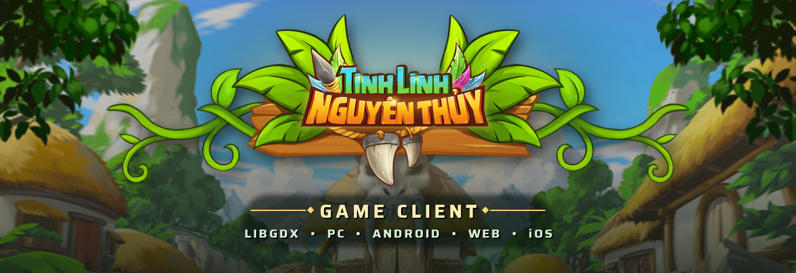
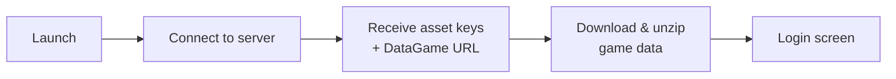
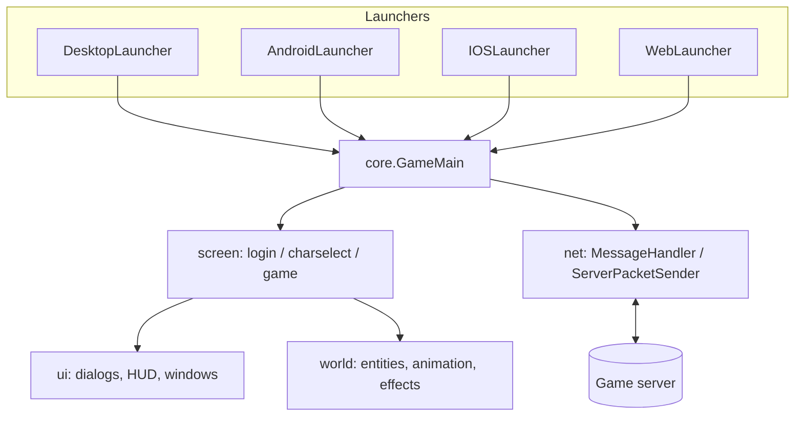

<div align="center">



<p>
  
  
  
  
</p>
<p>
  
  
  
  
</p>

**Cross-platform client for Tinh Linh Khởi Nguyên.** One Java code base ships to Windows PC, Android, Web (HTML5) and iOS.

[Quick start](#-quick-start) · [Configuration](#%EF%B8%8F-configuration-clientproperties) · [Release builds](#-release-builds-with-buildbat) · [Platforms](#-platforms) · [Source guide](#-source-code-guide) · [Troubleshooting](#-troubleshooting)

</div>

---

> [!IMPORTANT]
> The client needs a running game server. The server lives next to it in this repository, in
> [`../TinhLinhKhoiNguyen-Server`](../TinhLinhKhoiNguyen-Server/). The client does not work on its own.

## 🎯 Platforms at a glance

| | Platform | Backend | Output |
|:-:|---|---|---|
| 🖥️ | **Windows PC** | LWJGL3 + bundled trimmed JRE (jlink) | game folder, or an Inno Setup installer `.exe` |
| 📱 | **Android** | libGDX Android backend, R8 | signed `.apk` / `.aab` |
| 🌐 | **Web** | [gdx-teavm](https://github.com/xpenatan/gdx-teavm) (Java → JavaScript + WebAssembly) | static site (`index.html`, `app.js`, assets) |
| 🍎 | **iOS** | MobiVM / RoboVM (AOT to native ARM64) | `.ipa` (build on macOS only) |

The in-game text is Vietnamese; code comments and documentation are in English.

<details>
<summary><b>📚 Table of contents</b></summary>

- [Tech stack](#-tech-stack)
- [Prerequisites](#-prerequisites)
- [Quick start](#-quick-start)
- [Configuration (`client.properties`)](#%EF%B8%8F-configuration-clientproperties)
- [Release builds with `build.bat`](#-release-builds-with-buildbat)
- [Platforms](#-platforms): [Windows PC](#%EF%B8%8F-windows-pc) · [Android](#-android) · [Web](#-web-html5) · [iOS](#-ios)
- [Obfuscation and mapping files](#-obfuscation-and-mapping-files)
- [Project layout](#%EF%B8%8F-project-layout)
- [Source code guide](#-source-code-guide)
- [Tests](#-tests)
- [Changing the icon and branding](#-changing-the-icon-and-branding)
- [Troubleshooting](#-troubleshooting)
</details>

---

## 🧱 Tech stack

| Component | Version | Defined in |
|---|---|---|
| libGDX | 1.12.1 | `gradle.properties` (`gdxVersion`) |
| gdx-teavm (Web) | 1.6.2 | `gradle.properties` (`gdxTeaVMVersion`) |
| MobiVM / RoboVM (iOS) | 2.3.26 | `gradle.properties` (`roboVMVersion`) |
| Gradle (wrapper) | 8.13 | `gradle/wrapper/gradle-wrapper.properties` |
| Android Gradle Plugin | 8.9.3 | `build.gradle` |
| Android SDK | compile/target 35, min 26 | `android/build.gradle` |
| Java toolchain | JDK 20 (core is compiled to Java 8 bytecode) | `core/build.gradle`, `desktop/build.gradle` |
| ProGuard | 7.5.0 (PC + iOS) | `build.gradle` |
| Networking | KryoNet (TCP) on native platforms, WebSocket on the Web | `core/.../net`, `web/.../net` |
| Animation | Spine runtime (bundled in `core/.../thirdparty/spine`) | — |

Third-party libraries that are not on Maven (kryo/kryonet, textratypist, jackson, …) are bundled in `libs/tlnt-libs.jar`.

## 🧰 Prerequisites

Install once per machine.

| Tool | Needed for | Notes |
|---|---|---|
| **JDK 20** | everything | Set `JAVA_HOME` to it. `jlink` (PC runtime) and `keytool` (APK signing) come from this JDK. |
| **Android SDK** (platform 35 + build-tools 35) | Android | Set `sdk.dir` in `client.properties` or `ANDROID_HOME`. Without an SDK the `android` module is skipped and the other platforms still build. |
| **Inno Setup 6** | PC installer only | `winget install JRSoftware.InnoSetup`, or pass `-Ptlnt.iscc="<path>\ISCC.exe"`. |
| **Node.js** | testing the Web build locally (optional) | Runs `web/server.js`. |
| **macOS + Xcode + Apple Developer certificate** | real iOS builds | Windows can only compile and obfuscate the iOS code. |
| **adb** (Android platform-tools) | `build.bat install` (optional) | Installs the APK on a phone or emulator. |

Gradle downloads everything else (libGDX, plugins, dependencies) on the first build, so the first build must be online.

---

## 🚀 Quick start

```bat
git clone <repository-url> TinhLinhKhoiNguyen
cd TinhLinhKhoiNguyen\TinhLinhKhoiNguyen-Client

:: 1. create your local configuration (git-ignored)
copy client.properties.example client.properties

:: 2. edit client.properties: server.host / server.port must point at a running game server

:: 3. run the PC client from source (first run downloads dependencies)
gradlew desktop:run
```

`build.bat run` does the same thing with the project's default flags. On macOS / Linux use `./gradlew desktop:run`.



On first launch the client connects to the server. The server sends the download link for the game data, and the client downloads and extracts it into the data folder (see `storage.folder` below) before showing the login screen.

> [!TIP]
> **IDE:** open this folder as a Gradle project in IntelliJ IDEA or Android Studio. Run configuration: main class
> `com.shimaota.DesktopLauncher`, module `desktop`, working directory = this folder.

---

## ⚙️ Configuration (`client.properties`)

`client.properties` in this folder is the **only** file you need to edit to rebrand the client or point it at another server. Create it from `client.properties.example`. It is listed in `.gitignore`, so every machine keeps its own copy.

| Key | Meaning |
|---|---|
| `sdk.dir` | Android SDK path, e.g. `C:/Android/Sdk` (Android builds only). |
| `game.name` | Window title, Android / iOS app name, PC installer name and shortcut. |
| `storage.folder` | Data folder. PC: `C:\Users\<user>\AppData\LocalLow\<storage.folder>\`, Android: `<external storage>/<storage.folder>/`. Empty = `game.name`. |
| `prefs.folder` | PC settings + saved accounts: `C:\Users\<user>\.<prefs.folder>\` (default `.tlnt`). Kept apart from the data folder, so the in-game "Xóa dữ liệu" (clear data) button never deletes accounts. |
| `prefs.prefix` | Settings file name prefix (Android: SharedPreferences name). |
| `server.name` / `server.host` / `server.port` | Default server, used until the player picks another one. On phones, never use `localhost`. |
| `server.ws.url` | WebSocket URL for the Web client, e.g. `ws://127.0.0.1:7503/ws`, or `wss://example.com/ws` when the page is served over HTTPS. |

> [!NOTE]
> At build time `:core:generateClientConfig` embeds these values into the jar (class `ClientConfigGenerated`), together with `game.version` = `appVersionName`. Changing the configuration therefore means **rebuilding**. There is no config file next to the installed game.

> [!WARNING]
> The file **must be saved as UTF-8**. If it is saved as ANSI, accented characters turn into `?`, and the build fails rather than produce a broken client.

**One-off overrides** without editing the file: `build.bat ... host=1.2.3.4 port=7502 name=Server1 "game=Game Name" wsurl=wss://...`, or environment variables `TLNT_<KEY>` (e.g. `TLNT_SERVER_HOST`, `TLNT_GAME_NAME`). Avoid `-Ptlnt.<key>=` for accented values, because Windows converts them to `?` on the command line.

**Versioning** lives in `gradle.properties`:

| Key | Meaning |
|---|---|
| `appVersionName` | Version shown to players (e.g. `0.0.2`), also sent in the server handshake. |
| `appVersionCode` | Integer build number for Android / iOS. **Increase it for every release**, otherwise devices refuse to install the update over the old version. |
| `appId` | Android application id / iOS bundle id (`com.tlnt.game`). |

---

## 📦 Release builds with `build.bat`

`build.bat` (Windows) wraps all Gradle tasks. Run it without arguments for an interactive menu, or pass a command:

| Command | Result |
|---|---|
| `build.bat pc` | Obfuscated PC game folder `release\pc\TLNT\` (launch with `TLNT.bat`; JRE bundled, no Java install needed). |
| `build.bat setup` | PC installer `release\TLNT-Setup-<ver>.exe`. |
| `build.bat apk` | Signed, obfuscated release APK `release\TLNT-<ver>.apk`. |
| `build.bat apkdebug` | Debug APK, not obfuscated (quick test install). |
| `build.bat aab` | Release AAB for Google Play `release\TLNT-<ver>.aab`. |
| `build.bat web` | Web client `release\web\`. |
| `build.bat all` | `setup` + `apk` + `web`, built in parallel. |
| `build.bat install` | Installs the newest APK from `release\` with `adb`. |
| `build.bat ios` | Compiles + obfuscates the iOS code (a real IPA needs a Mac). |
| `build.bat test` | Runs the client tests. |
| `build.bat run` | Runs the client from source. |
| `build.bat server` | Builds the server jar `..\TinhLinhKhoiNguyen-Server\TLKN-Server\target\tlnt-server.jar`. |
| `build.bat clean` | Deletes old build output. |

Extra parameters go **after** the command, as `key=value`:

```bat
build.bat all host=203.0.113.10 port=7502       :: override the default server for this build only
build.bat apk host=10.0.2.2                      :: Android emulator -> server running on this PC
build.bat web wsurl=wss://game.example.com/ws    :: Web client WebSocket URL
build.bat pc obf=off                             :: no obfuscation (debugging)
build.bat apk online                             :: allow downloading missing libraries
build.bat setup nopause                          :: do not wait for a key at the end (CI / scripts)
```

- Builds run `--offline` by default for speed. If a build fails because a **library is missing**, `build.bat` retries online automatically. Code errors are reported immediately.
- The log of the last build is `build\build.log`; `build.bat` prints fix hints for common errors.
- Everything in `release\` is git-ignored.

Plain Gradle works too (`gradlew <task>`, see the platform sections below) on any OS.

---

## 🧩 Platforms

### 🖥️ Windows PC

| Gradle task | Output |
|---|---|
| `desktop:run` | Runs from source. |
| `desktop:distObf` | Obfuscated fat jar `desktop/build/dist/TLNT.jar` (runs on any Java 8+). |
| `desktop:exe` | `desktop/build/exe/TLNT/` = `TLNT.bat` + `app/TLNT.jar` + `runtime/` (trimmed JRE). |
| `desktop:setup` | `desktop/build/setup/TLNT-Setup-<ver>.exe` (needs Inno Setup 6). |

- **Obfuscation** (`:desktop:obfJar`): ProGuard obfuscates only the project's own classes (`com.tlnt.**`, `com.shimaota.**`); libraries keep their names. Rules: `desktop/proguard.pro`. Renaming style: `-Pobf=mixed` (default: ASCII class names, Cyrillic + zero-width member names), `ascii`, `unicode` or `off`. Bytecode optimization is off by default; turn it on with `-Popt=on` and test thoroughly.
- **Runtime**: `desktop:exeRuntime` uses `jlink` to build a ~55 MB JRE, so players don't need Java. It is cached between builds; pass `-PfreshRuntime` to rebuild it.
- **JVM options**: `-Xms64m -Xmx1g` + periodic G1 GC (`desktop/launcher/TLNT.bat`, `desktop/setup.iss`).
- **Installer** (`desktop/setup.iss`): Vietnamese UI, per-user install (no admin rights, no UAC prompt), Desktop and Start Menu shortcuts. It refuses install paths containing accented characters, because Java cannot load `java.dll` from such paths.

### 📱 Android

| Gradle task | Output |
|---|---|
| `android:assembleDebug` | Debug APK. |
| `android:assembleRelease` | Signed, R8-obfuscated release APK. |
| `android:bundleRelease` | Release AAB (Google Play). |

**Signing setup** (required for release builds). The signing key is **not** part of the repository. Create it once:

```bat
keytool -genkeypair -v -keystore android/tlnt-release.jks -alias tlnt -keyalg RSA -keysize 2048 -validity 10000
copy android\keystore.properties.example android\keystore.properties
```

Then fill in `android/keystore.properties`:

```properties
storeFile=tlnt-release.jks
storePassword=<store password>
keyAlias=tlnt
keyPassword=<key password>
```

Alternatively pass `-PtlntStoreFile=... -PtlntStorePassword=... -PtlntKeyAlias=... -PtlntKeyPassword=...`. Without a key, Gradle produces `android-release-unsigned.apk`, which cannot be installed.

> [!CAUTION]
> **Back up the `.jks` file and its passwords somewhere safe, and never commit them.** If the key is lost, you can no longer publish updates that install over the existing app.

- **Obfuscation**: R8 with `android/proguard-rules.pro` (ASCII dictionary). Turn it off with `-Pobf=off`, or use `build.bat apkdebug`.
- **Server address**: on a phone, `localhost` / `127.0.0.1` is the phone itself. Build with a real IP or domain, e.g. `build.bat apk host=192.168.1.15`. The Android emulator reaches the host PC at `10.0.2.2`.
- **Native libraries**: `copyAndroidNatives` extracts libGDX `.so` files into `android/libs/<abi>/` on every build.

### 🌐 Web (HTML5)

| Gradle task | Output |
|---|---|
| `web:gdx_teavm_web_js_build` | `web/build/dist/js/webapp/` (`index.html`, `app.js`, `box2D.wasm.wasm`, `assets/`). `build.bat web` copies it to `release\web\`. |

- TeaVM compiles `:core` + `:web` to JavaScript; Box2D and FreeType run as WebAssembly.
- Release builds are obfuscated and minified (`OptimizationLevel.BALANCED`, no debug info, no source maps). Use `build.bat web obf=off` for readable stack traces in the browser DevTools.
- **Run locally**: `node web\server.js` (or `web\run_web.bat`, which builds first if needed), then open `http://localhost:8080`.
- **Deploy**: upload the contents of `release\web\` to any static web server. Serve it over HTTPS together with a `wss://` WebSocket endpoint on the game server.

**WebSocket URL**, resolved in this order (`TeaVMWebSocketClient`), so it can be changed **without rebuilding**:

1. URL parameter `?ws=...` (also `?wsUrl=` / `?ws_url=`)
2. `window.TLKN_WS_URL` set in `index.html`
3. `<meta name="tlkn-ws-url" content="...">`
4. `server.ws.url` from `client.properties`
5. fallback: current scheme + host + `/ws`

<details>
<summary><b>Developer URL switches</b></summary>

| Switch | Effect |
|---|---|
| `?perf` | Sends frame-time stats to `web/server.js` (written to `web/perf.log`) |
| `?glfix=0` | Disables the Safari buffer workaround (`web/webapp/glfix.js`) |
| `?dpr=N` | Overrides the pixel-ratio cap |
| `?fs=0` | Disables auto-fullscreen on phones |

`web/webapp/bench.html` is a WebGL upload benchmark used during development; you do not need to deploy it.
</details>

### 🍎 iOS

| Gradle task | Where | Output |
|---|---|---|
| `ios:obfJar` | any OS | `ios/build/obf/core-obf.jar` + `mapping.txt` |
| `ios:launchIPhoneSimulator` | macOS | runs in the iPhone simulator |
| `ios:createIPA` | macOS | `.ipa` for TestFlight / App Store |

- RoboVM compiles Java ahead-of-time to native ARM64 (arm64 only; Apple rejects 32-bit builds).
- ProGuard still runs first (`ios/proguard-rules.pro`), because class and method names would otherwise remain readable in the binary's symbols and reflection metadata.
- Build-time steps on macOS: `convertIosAudio` converts `sounds/*.ogg` to `.m4a` (iOS cannot play Ogg), and `compileIosIcons` compiles the asset catalog with `actool`.
- App name, version, build number and bundle id come from `client.properties` / `gradle.properties` (`ios/robovm.properties` is generated). Override the bundle id with `-Ptlnt.ios.bundleId=...`.
- The signing identity and provisioning profile are configured on the Mac in `ios/robovm.properties` / `ios/robovm.xml`.

---

## 🔒 Obfuscation and mapping files

All release builds are obfuscated: ProGuard (PC, iOS), R8 (Android), TeaVM minification (Web). Mapping files are needed to decode stack traces in players' crash reports (`crash.txt` in the data folder):

| Platform | Mapping |
|---|---|
| PC | `release\mapping-pc-<ver>.txt` (`desktop/build/obf/mapping.txt`) |
| Android | `release\mapping-apk-<ver>.txt` (`android/build/outputs/mapping/release/mapping.txt`) |
| iOS | `release\mapping-ios-<ver>.txt` (`ios/build/obf/mapping.txt`) |

> [!IMPORTANT]
> **Archive the mapping file of every published version.** Without it, crash reports from that version cannot be decoded.

**Names that must never be obfuscated:**

- `com.tlnt.net.DataPacket` and `com.tlnt.net.FragmentPacket`: Kryo's `FieldSerializer` writes fields **in alphabetical order of their names**, so renaming a field breaks the network protocol with the server.
- Launchers: `DesktopLauncher`, `AndroidLauncher`, `IOSLauncher`, `WebLauncher`.

If you add code that uses reflection by name (or JNI / Objective-C bindings), add a `-keep` rule to **all three** files: `desktop/proguard.pro`, `android/proguard-rules.pro`, `ios/proguard-rules.pro`.

---

## 🗂️ Project layout

```
TinhLinhKhoiNguyen-Client/
├── build.bat                  Windows build front end (menu + commands)
├── build.gradle               shared build logic, client.properties overrides, library jars
├── settings.gradle            modules: core, desktop, web (+ android when an SDK is found, + ios)
├── gradle.properties          library versions, app version, app id
├── client.properties.example  template for client.properties (git-ignored)
├── libs/tlnt-libs.jar         bundled third-party libraries not available on Maven
├── assets/                    game assets packed into every build (images, skeletons, fonts, sounds, skin, packs)
├── core/                      ALL game code, platform independent
│   ├── src/main/java/com/tlnt/...
│   └── src/test/java/...      unit tests (JUnit)
├── desktop/                   PC launcher, ProGuard rules, jlink runtime, Inno Setup installer
│   ├── src/main/java/com/shimaota/DesktopLauncher.java
│   ├── launcher/TLNT.bat      launcher script of the game folder
│   ├── setup.iss              installer script
│   └── obf/                   obfuscation name dictionaries
├── android/                   Android launcher, manifest, resources, R8 rules, signing config
├── ios/                       RoboVM launcher, Info.plist, robovm.xml, asset catalog, patched libGDX iOS backend
├── web/                       TeaVM launcher, WebSocket client, patched web backend, webapp/ (HTML shell), server.js
└── release/                   build outputs from build.bat (git-ignored)
```

---

## 🧭 Source code guide

### Entry points

| Platform | Launcher | Platform-specific pieces |
|---|---|---|
| PC | `desktop/.../com/shimaota/DesktopLauncher.java` | window icons, Preferences location, migration of old settings |
| Android | `android/.../com/tlnt/android/AndroidLauncher.java` | `KeyboardHeightProvider` (soft keyboard height) |
| iOS | `ios/.../com/tlnt/ios/IOSLauncher.java` | `IOSSceneDelegate` (UIScene lifecycle), `JavaxAesBackend` (fast AES), `OggToM4aAudio` |
| Web | `web/.../com/tlnt/web/WebLauncher.java` | `TeaVMWebSocketClient`, `WireCodec`, `TeaVMHttpHandler`, `TeaVMWebStorage` |

Every launcher creates `com.tlnt.core.GameMain`, the libGDX `ApplicationListener`.



### `core` packages (`core/src/main/java/com/tlnt/`)

| Package | Contents |
|---|---|
| `core` | `GameMain` (lifecycle), `GameState` (global client state), `Settings` (player settings), `ClientConfig` (branding / default server), `GameDataLoader` (parses downloaded game data), `CrashHandler`, asset loading (`asset/`), audio, object pools (`factory/`). |
| `net` | Network layer. `KryoNetworkClient` (TCP), `MessageHandler` (dispatches server → client packets by opcode), `task/ServerPacketHandler` (packet handlers), `task/ServerPacketSender` (client → server packets), `DataPacket` / `FragmentPacket` (wire format). |
| `screen` | libGDX screens: `login`, `charselect`, `game`, plus base classes (`BaseScreen`, `Scene2dScreen`). |
| `ui` | scene2d UI: `dialog/` (login, loading, messages), `hud/` (in-game HUD and widgets), `window/` (inventory, forge, party, tribe, mail, market, shop, settings, world boss, …), `widget/` (shared controls). |
| `world` | The game world: `entity/` (player, mob, NPC, animal, pet, decorations), `anim/` (animation state machines per weapon / mob / boss), `skeleton/` (Spine rendering), `effect/`, `groundeffect/`, `projectile/`, `label/` (names, health bars). |
| `model` | Plain data objects received from the server (items, skills, quests, ranking, mail, market, …). |
| `engine` | Low-level helpers: camera, input, particles, Box2D physics wrapper, rendering (`RenderContext`, textures), fonts, scene graph, pools. |
| `util` | `AesDecryptor` (asset decryption), `FileStorage` (data folder, Preferences, unzip), `HttpClient` (downloads), `TimeFormatter`, `GameUtils`. |
| `thirdparty` | Bundled Spine runtime and ShapeDrawer (with local fixes). |

### Important flows

- **Startup and data download**: `GameMain.create` → login screen → the server sends the data URL → `ui/dialog/ResourceDownloadTask` + `LoadingDialog` download and unzip files one by one into the data folder (`util/FileStorage`). Encrypted atlases are decrypted with the key sent by the server (opcode 59, `core/asset/EncryptedTextureAtlas`).
- **Networking**: packets are opcode + sub-opcode + payload. To find what a packet does, start from `MessageHandler` (switch on the opcode, S→C) or `ServerPacketSender` (C→S). Keep packet layouts byte-compatible with the server; the server's opcode list is `TinhLinhKhoiNguyen-Server/TLKN-Server/src/main/java/com/tlnt/server/net/Opcode.java`.
- **Movement and auto-attack**: `world/entity/player/component/`: `PlayerMovementController` (local player, sends its position 20×/s), `ClickMoveController` (interpolation of other players), `InteractionController`, `AutoTargetController`, `AttackReach`, `OffscreenTargetArrow` (auto-pathing).
- **Pets** are simulated on each client: `world/entity/player/pet/PetBrain` + `PetTerrain`.
- **Memory management**: `core/asset/SkeletonLoader` reference-counts Spine atlases and frees unused ones (LRU, 256 MB budget); off-screen skeletons are not drawn (`SpineSkeletonComponent`).

### Conventions

- Parts of the code base were recovered from compiled bytecode, so some class and method names do not match what the code does. Trust the behavior, not the name, and rename carefully (never rename `DataPacket` / `FragmentPacket` fields).
- Comments explain *why* a piece of code is the way it is (bugs fixed, protocol details, performance measurements). Keep them up to date when changing that code.
- UI strings are Vietnamese and live directly in the code.
- `CLAUDE.md` contains notes for contributors and AI assistants: rules and the list of areas changed so far.

---

## 🧪 Tests

```bat
gradlew :core:test
```

Tests cover pure logic that does not need libGDX (e.g. `PetBrainTest` for the client-side pet simulation). `build.bat test` runs the same tests.

## 🎨 Changing the icon and branding

| What | Where |
|---|---|
| Name, data folder, default server | `client.properties` ([Configuration](#%EF%B8%8F-configuration-clientproperties)) |
| PC window / taskbar icon | `assets/images/icon.png` and `icon_16..128.png` |
| PC executable and installer | `desktop/icon.ico` (16–256 px) |
| Android | `android/res/mipmap-*/ic_launcher.png` and `ic_launcher_round.png` (5 densities) |
| iOS | `ios/data/Assets.xcassets/AppIcon.appiconset/` (keep the file names and sizes from `Contents.json`) |
| Web | `web/webapp/assets/startup-logo.png`, `web/favicon.ico`, `web/webapp/manifest.json` |

---

## 🩺 Troubleshooting

| Problem | Cause and fix |
|---|---|
| `No cached version ... available for offline mode` | A library is missing from the Gradle cache. Run `build.bat <command> online` (or plain `gradlew` without `--offline`). |
| `Failed to clean up stale outputs ... sound_x.ogg` | The game (or an IDE run) still has the file open. Close the game and build again. |
| `'gradlew.bat' is not recognized` | Windows has `NoDefaultCurrentDirectoryInExePath` set. Use `build.bat`, or type `.\gradlew.bat`. |
| `Khong thay Inno Setup` | Inno Setup is not installed: `winget install JRSoftware.InnoSetup`. |
| Gradle complains about the JDK / toolchain | `JAVA_HOME` must point at JDK 20 (AGP needs at least JDK 17 for the Gradle daemon). |
| `client.properties` error about UTF-8 | The file was saved as ANSI. Save it as UTF-8. |
| APK installs but cannot connect | `server.host` is still `localhost`. Use the PC's LAN IP or a real domain (`build.bat apk host=192.168.1.x`). |
| Crash on startup: `NoClassDefFoundError: box2dLight/RayHandler` | Libraries in `mavenLibs` (root `build.gradle`) must be `implementation` dependencies of `desktop`, `android` and `ios`, because `core` only has them as `compileOnly`. |
| Android update refuses to install | `appVersionCode` was not increased, or the APK was signed with a different key. |
| LDPlayer / emulator freezes while installing | Hyper-V / Virtual Machine Platform conflicts with the emulator. Turn them off in Windows Features and reboot. |
| PC game does not start from a folder with accented characters | Java cannot load `java.dll` from such paths. The installer blocks them; when using the zip, extract it to a plain path such as `D:\Games\TLNT`. |
| Web client cannot connect over HTTPS | Browsers block `ws://` from `https://` pages. Use a `wss://` URL (`?ws=wss://...` or `server.ws.url`). |
| A player sends `crash.txt` with unreadable names | Decode it with the mapping file of that version ([Obfuscation](#-obfuscation-and-mapping-files)). |

<div align="center">
<sub>⬆️ <a href="../README.md">Back to the main README</a></sub>
</div>
