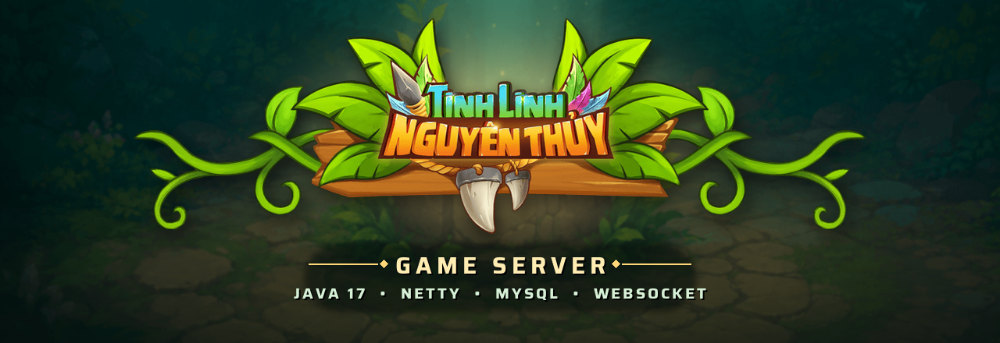
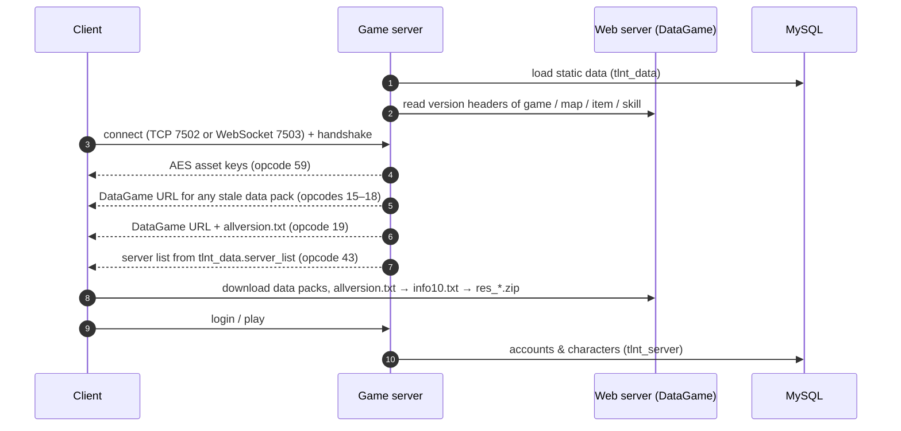
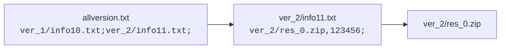

<div align="center">



<p>
  
  
  
  
</p>

**Java 17 game server for Tinh Linh Khởi Nguyên.** It also holds the `DataGame` resource files the client downloads and the SQL to set up the databases.

[Quick start](#-quick-start) · [Database](#%EF%B8%8F-1-database) · [DataGame](#-2-serving-datagame) · [Configuration](#%EF%B8%8F-3-configure) · [Asset keys](#-asset-keys) · [Troubleshooting](#-troubleshooting)

</div>

---

## 📋 At a glance

| | |
|---|---|
| **Runtime** | JDK 17+, one fat jar (`target/tlnt-server.jar`) |
| **Network** | TCP `7502` for native clients, WebSocket `7503` for the browser |
| **Storage** | `tlnt_data` (static game data, read at startup) + `tlnt_server` (accounts & characters) |
| **Assets** | `DataGame/` served by any static web server or CDN |
| **Admin** | Web panel on `127.0.0.1:8090` (loopback only) |

## 📁 Folder layout

```
TinhLinhKhoiNguyen-Server/
├── TLKN-Server/                     Java server (Maven project)
│   ├── src/main/                    source code + admin panel web files
│   ├── Assest/                      decrypted images used only by the admin panel
│   ├── local-repo/                  bundled KryoNet build (must match the client, do not replace)
│   ├── server.properties.example    config template → copy to server.properties
│   └── start.bat / start.sh         build if needed + run
├── DataGame/                        files served over HTTP to the client
│   ├── game, item, map, skill       static data packs (first 4 bytes = version)
│   ├── allversion.txt               list of resource-pack index files
│   └── ver_1/                       info10.txt + res_0..21.zip (encrypted textures / skeletons)
├── database/
│   ├── tlnt_data.sql                static game data (items, maps, mobs, shops, server list …)
│   └── tlnt_server_schema.sql       accounts + characters, empty schema
└── tools/check_asset_keys.py        verifies the AES asset keys against DataGame
```

## 🔗 How the pieces connect



You need three things running: **MySQL/MariaDB**, **a web server for `DataGame`**, and **the game server**.

---

## ⚡ Quick start

> [!TIP]
> Local test on one machine, about 5 minutes. Each step is explained in detail below.

```bash
# 1. databases
mysql -u root -p -e "CREATE DATABASE tlnt_data CHARACTER SET utf8mb4 COLLATE utf8mb4_unicode_ci; CREATE DATABASE tlnt_server CHARACTER SET utf8mb4 COLLATE utf8mb4_unicode_ci;"
mysql -u root -p tlnt_data   < database/tlnt_data.sql
mysql -u root -p tlnt_server < database/tlnt_server_schema.sql

# 2. serve DataGame (keep this terminal open)
python -m http.server 8080
```

```bash
# 3. in a second terminal: configure + run
cd TLKN-Server
cp server.properties.example server.properties     # Windows: copy server.properties.example server.properties
./start.sh                                         # Windows: start.bat
```

You should see the `TLNT Game Server - SAN SANG` banner and `Data version: game=13 map=3 item=15 skill=6`.

---

## 🧰 Requirements

| Tool | Version | Notes |
|---|---|---|
| JDK | 17 or newer | `java -version` |
| MySQL / MariaDB | MySQL 8 / MariaDB 10.4+ | XAMPP works fine on Windows |
| Static web server | any | nginx, Apache (XAMPP), IIS, a CDN, or `python -m http.server` for local testing |
| Maven | not required | the bundled wrapper `mvnw` / `mvnw.cmd` downloads Maven 3.9.9 |

## 🗄️ 1. Database

The dumps do **not** contain `CREATE DATABASE`, so create both databases first. `utf8mb4` is required because names and chat are Vietnamese.

```sql
CREATE DATABASE tlnt_data   CHARACTER SET utf8mb4 COLLATE utf8mb4_unicode_ci;
CREATE DATABASE tlnt_server CHARACTER SET utf8mb4 COLLATE utf8mb4_unicode_ci;
```

<table>
<tr><th>Command line</th><th>phpMyAdmin (XAMPP)</th></tr>
<tr><td>

```bash
mysql -u root -p tlnt_data   < database/tlnt_data.sql
mysql -u root -p tlnt_server < database/tlnt_server_schema.sql
```

</td><td>

Select the database → **Import** → choose the file → **Go**.
Repeat for the second database.

</td></tr>
</table>

> [!IMPORTANT]
> The server does **not** create tables itself. Both imports are required.

<details>
<summary><b>Recommended: a dedicated DB user instead of <code>root</code></b></summary>

```sql
CREATE USER 'tlnt'@'localhost' IDENTIFIED BY 'change-me';
GRANT ALL PRIVILEGES ON tlnt_data.*   TO 'tlnt'@'localhost';
GRANT ALL PRIVILEGES ON tlnt_server.* TO 'tlnt'@'localhost';
FLUSH PRIVILEGES;
```
</details>

### Server list

The server list in the client comes from `tlnt_data.server_list`.

> [!WARNING]
> In the shipped data **both rows are `enabled = 0`**, so the client receives an empty list. Enable a row and point it at your public address:

```sql
UPDATE tlnt_data.server_list SET name='Server 1', host='203.0.113.10', port=7502, enabled=1 WHERE id=1;
```

`host` must be reachable by players (public IP or domain), not `127.0.0.1`, unless you only test on the same machine. You can also edit this table in the admin panel. The server reloads it every 60 seconds, so no restart is needed.

## 🌐 2. Serving DataGame

`DataGame/` must be reachable over HTTP at the URL you set in `datagame.httpBaseUrl`. The client builds every download URL from it: `<httpBaseUrl>/game`, `<httpBaseUrl>/allversion.txt`, `<httpBaseUrl>/ver_1/res_0.zip` and so on.

<details open>
<summary><b>Option A: local testing (Python)</b></summary>

From this folder (the one that contains `DataGame/`):

```bash
python -m http.server 8080
```

```properties
datagame.httpBaseUrl=http://127.0.0.1:8080/DataGame
```
</details>

<details>
<summary><b>Option B: XAMPP / Apache on Windows</b></summary>

Copy `DataGame` into `C:\xampp\htdocs\` and start Apache. To link it instead of copying, run cmd as Administrator:

```bat
mklink /D C:\xampp\htdocs\DataGame "C:\path\to\TinhLinhKhoiNguyen-Server\DataGame"
```

```properties
datagame.httpBaseUrl=http://<your-public-ip>/DataGame
```
</details>

<details>
<summary><b>Option C: nginx on Linux</b></summary>

```nginx
server {
    listen 80;
    server_name cdn.example.com;

    location /DataGame/ {
        alias /opt/tlnt/DataGame/;
        autoindex off;
        add_header Access-Control-Allow-Origin *;   # needed for the browser (WebSocket) client
    }
}
```

```properties
datagame.httpBaseUrl=http://cdn.example.com/DataGame
```
</details>

<details>
<summary><b>Option D: CDN / another machine</b></summary>

Upload the `DataGame` folder as-is and set `datagame.httpBaseUrl` to its public URL. Leave `datagame.dir=` **empty**. The server then reads the 4-byte version headers over HTTP, using a `Range: bytes=0-3` request, so this is cheap.
</details>

**Check it.** Each of these must download, not 404:

| URL | Expected content |
|---|---|
| `<httpBaseUrl>/allversion.txt` | `ver_1/info10.txt;` |
| `<httpBaseUrl>/ver_1/info10.txt` | `ver_1/res_0.zip,10498190;…` |
| `<httpBaseUrl>/game` | binary file |

| Key | Used by | Purpose |
|---|---|---|
| `datagame.httpBaseUrl` | **client** (sent by the server) + server fallback | Public URL of the DataGame folder |
| `datagame.dir` | server only | Local path for reading versions from disk: `../DataGame` when you run from `TLKN-Server/`, empty if DataGame is remote |

## ⚙️ 3. Configure

```bash
cd TLKN-Server
cp server.properties.example server.properties
```

| Key | Set to |
|---|---|
| `datagame.httpBaseUrl` | public URL from step 2 |
| `datagame.dir` | `../DataGame`, or empty if DataGame is remote |
| `db.url`, `db.player.url` | your MySQL host / port / database names |
| `db.user`, `db.password` | the DB user from step 1 |
| `admin.password` | set one on any shared machine |

> [!NOTE]
> `server.properties` is git-ignored; only the `.example` file is committed. The file is read from the **current working directory**, so always start the server from `TLKN-Server/`.

## ▶️ 4. Build & run

```bash
cd TLKN-Server
./mvnw -B package                 # Windows: mvnw.cmd -B package
java -jar target/tlnt-server.jar
```

Or just run **`start.bat`** (Windows) or **`./start.sh`** (Linux). They copy the config template if it's missing, build if `target/tlnt-server.jar` doesn't exist, and start the server.

If the log shows `Data version: game=0 …`, the server cannot read DataGame. Check `datagame.dir` and `datagame.httpBaseUrl`.

> [!CAUTION]
> **To stop the server, type `stop` in the console** (Ctrl+C also works). The server kicks players gradually and waits until every character is saved. Never kill the process or close the window while players are online, or their progress is lost. Saves that fail to reach SQL are written to `failed_saves/`.

### Ports

| Port | Purpose | Open to the internet? |
|---|---|---|
| `7502/tcp` | game client | ✅ yes |
| `7503/tcp` | browser client (WebSocket) | ✅ if you use the web client |
| `80` / `443` | DataGame web server | ✅ yes |
| `3306` | MySQL | ❌ **no** |
| `8090` | admin panel | ❌ **no** (it only accepts 127.0.0.1) |

### Admin panel

Open `http://127.0.0.1:8090` **on the server machine**. On a VPS, use an SSH tunnel:

```bash
ssh -L 8090:127.0.0.1:8090 user@your-vps
```

---

## 🔐 Asset keys

The textures and skeleton atlases inside `DataGame/ver_*/res_*.zip` are encrypted with **AES-128-CBC** (the IV is the first 16 bytes; PKCS5 padding). The server sends both keys to the client during the handshake (opcode 59).

| Key | Decrypts |
|---|---|
| `assets.textureDecryptKey` | `icon/`, `ui/`, `objects/` images |
| `assets.atlasDecryptKey` | skeleton atlas pages (`skeletons/**.png`) |

✅ The keys in `server.properties.example` were verified against **all 1,866 PNGs** in `DataGame/ver_1`:

| Folder | Texture key | Atlas key | Unencrypted | Failed |
|---|---:|---:|---:|---:|
| `icon/` | 982 | – | – | 0 |
| `objects/` | 691 | – | 1 | 0 |
| `skeletons/` | – | 173 | 19 | 0 |

Re-check after changing keys or resource packs:

```bash
pip install pycryptodome
python tools/check_asset_keys.py
```

The server refuses to start if a key isn't 32/48/64 hex characters. If the keys are empty, the client can only show unencrypted files.

## 🔄 Updating game data

### Static data packs (`game`, `item`, `map`, `skill`)

Each file starts with a 4-byte big-endian version. Replace the file in `DataGame/` with a new one that has a **higher version**, then restart the server (versions are read once at startup). Clients with a different version download the new file automatically.

> [!NOTE]
> The `data_version` table in `tlnt_data` is informational only. The server reads versions from the files, not from that table.

### Resource packs (`ver_*/res_*.zip`)

The client remembers which index files listed in `allversion.txt` it has already downloaded, and only fetches **new** ones.



1. Create a new folder, e.g. `DataGame/ver_2/`, with the new zip(s), encrypted with the same keys.
2. Create an index file, e.g. `ver_2/info11.txt`, with one `path,sizeInBytes;` entry per zip. The size must be the exact file size in bytes.
3. Append it to `allversion.txt`: `ver_1/info10.txt;ver_2/info11.txt;`

> [!WARNING]
> Never change a zip that has already been published. Existing clients won't download it again.

---

## 📖 Configuration reference

The common keys are in `server.properties.example`. Every key has a default in `ServerConfig.java`.

<details>
<summary><b>Advanced keys</b> (click to expand)</summary>

| Key | Default | Meaning |
|---|---|---|
| `net.transport` | `netty` | `netty` or legacy `kryonet` |
| `net.ioThreads` | CPU count | Netty I/O threads |
| `net.maxFrameBytes` | 65536 | max client packet size |
| `server.gameThreads` | CPU count | packet-handling threads |
| `server.blockingThreads` | CPU×2 | SQL / password hashing threads |
| `world.tickThreads` | CPU count | zone tick threads |
| `world.moveBroadcastMillis` | 50 | position broadcast interval |
| `db.player.poolSize` | blockingThreads+2 | player DB pool |
| `security.maxConnectionsPerIp` | 10 | 0 = unlimited (raise it for internet cafés) |
| `security.loginsPerIpPerMinute` | 10 | login rate limit |
| `security.failsPerAccount` | 10 | wrong passwords allowed in 15 min before the account is locked |
| `security.accountLockMinutes` | 5 | lock duration |
| `security.exemptLoopback` | true | no limits for 127.0.0.1 |
| `shutdown.kickPerSecond` | 200 | players saved per second on shutdown |
| `log.level` | INFO | DEBUG / INFO / WARN / ERROR |
| `log.color` | auto | auto / on / off |
| `stats.intervalSeconds` | 60 | print online / tick / memory stats, 0 = off |
| `achievement.guardianBosses` | 1,9,11,13,15 | `world_boss.id`s counted as Guardians |
| `achievement.spiritBosses` | 2,10,12,14,16 | `world_boss.id`s counted as Spirits |
| `tribe.*`, `linhmoc.*` | see `TribeConfig` / `LinhMocConfig` | tribe and Linh Mộc dungeon tuning |
</details>

## 🩺 Troubleshooting

| Symptom | Fix |
|---|---|
| `Cong TCP 7502 dang bi chiem` | Another server instance is running, or change `server.port` |
| `Communications link failure` | MySQL isn't running, or `db.url` is wrong |
| `Table 'tlnt_data.xxx' doesn't exist` | Step 1 import is missing |
| Client stuck on "downloading" / 404 | `datagame.httpBaseUrl` is wrong, or the web server isn't serving DataGame |
| `Data version: game=0 …` | The server can't read DataGame. Fix `datagame.dir` or the URL |
| Black / missing textures in the client | Wrong asset keys. Run `tools/check_asset_keys.py` |
| Empty server list in the client | No `server_list` row has `enabled = 1` |
| Admin panel shows text instead of icons | Run from `TLKN-Server/` so `Assest/` is found |
| Client connects, then disconnects instantly | Client/server KryoNet mismatch. Keep `local-repo/` as-is |

## 🛡️ Security checklist

- [ ] `database/tlnt_server_schema.sql` is structure only. Never commit a real dump with player accounts (emails, password hashes, IPs).
- [ ] `database/tlnt_data.sql` includes the gift codes in the `giftcode` table. Change or disable them on a live server if the repo is ever made public.
- [ ] Set `admin.password` and use a non-root DB user on any real server.
- [ ] Keep ports `3306` and `8090` closed to the internet.
- [ ] Every client receives the asset keys, so they don't keep players out. Publishing the repo still makes the encrypted assets trivial to decrypt.

<div align="center">
<sub>⬆️ <a href="../README.md">Back to the main README</a></sub>
</div>
